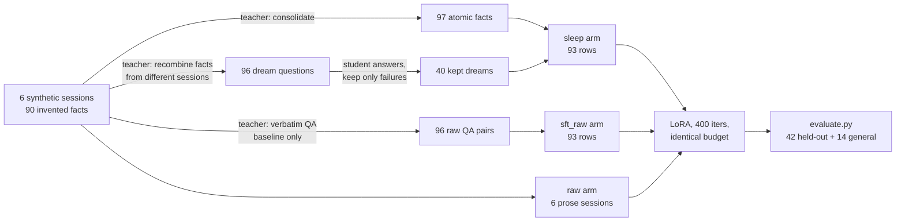
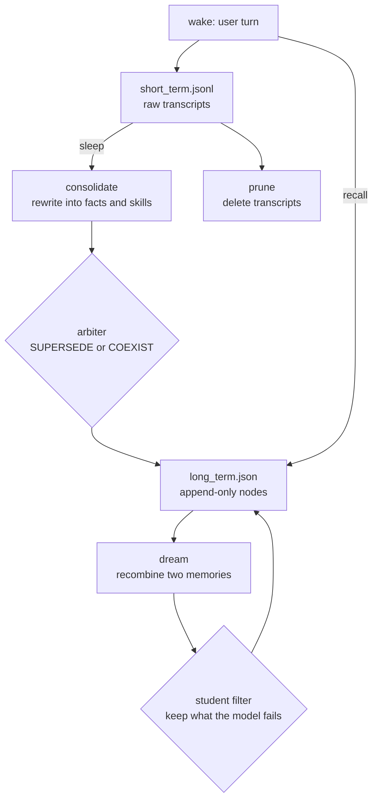

# sleep-replication

**Google's "Language Models Need Sleep" claims that consolidating memory into weights and rehearsing it in dreams beats both in-context learning and plain SFT. This is an attempt to test that on a Mac mini, with a 7B model and a LoRA budget, plus the honest answer about which parts of the claim survive.**

- [The result](#the-result) 
- [Architecture](#architecture) - [Quickstart](#quickstart) 
- [What this does not test](#what-this-does-not-test) 
- [Contributing](#contributing)

---

## The claim

The paper ([arXiv 2606.03979](https://arxiv.org/abs/2606.03979), Behrouz, Hashemi, Javanmard, Mirrokni) proposes a sleep phase for language models: during "sleep" the model consolidates short-term context into its parameters, then dreams, generating synthetic samples that carry new information, and trains on those. The headline results are class-incremental learning gains over ICL and SFT, near-zero forgetting on continual translation, and near-perfect long-context scaling on BABILong up to 10M tokens.

There is no official code release. Three GitHub repos use the word "sleep" for unrelated things (REM-cycle future-turn training, MEMIT weight editing, reflection loops). So the claim had not been tested outside the paper's own setup.

## The result

Six conditions, one student (Qwen2.5-7B-Instruct-4bit), deterministic substring scoring against hand-written answer keys, 42 held-out questions plus 14 general-knowledge probes. Training arms use identical iters, batch size, LR, LoRA rank and sequence length.

| condition | what it is | all | direct | 2-hop | general | ctx tokens |
|---|---|---|---|---|---|---|
| `base` | no context, no adapter | 0% | 0% | 0% | 100% | 0 |
| `icl_all` | all six transcripts in the prompt | **100%** | 100% | 100% | 100% | 1,032 |
| `icl_recent` | last two sessions only | 33% | 33% | 33% | 100% | 344 |
| `raw` | LoRA on the raw transcripts | 19% | 17% | 33% | 93% | 0 |
| `sft_raw` | LoRA on verbatim QA pairs from the transcripts | 12% | 14% | 0% | 64% | 0 |
| `sleep` | LoRA on consolidated QA + dreams the student failed | **45%** | 39% | **83%** | 93% | 0 |

Three seeds, every seed rebuilding both arms from a fresh dream sample:

| condition | n | all | direct | 2-hop | general |
|---|---|---|---|---|---|
| `sft_raw` | 3 | 11.9 ± 0.0 | 13.0 ± 1.6 | 5.6 ± 9.6 | 76.2 ± 8.2 |
| `sleep` | 3 | **37.3 ± 7.7** | 33.3 ± 7.3 | **61.1 ± 19.2** | 73.8 ± 8.2 |

Read it as three findings, not one:

1. **In context wins outright.** 100% at 1,032 tokens, no training. At this scale sleep is not *needed*; it is a way to trade context tokens for weights.
2. **Naive fine-tuning is worse than nothing useful.** Raw prose teaches regurgitation. Verbatim QA learns the values but binds them to the wrong service, and it scores the same 11.9% on all three seeds, which is what a systematic failure looks like.
3. **The consolidation + filtered-dream pipeline is the only weight-update arm that works.** 37.3% against 11.9%, and 61% on two-hop questions that neither baseline solves at all.

At 150 iterations the same arms are indistinguishable (12% vs 14%). The gap appears at 400 because the sleep data is still being absorbed while the verbatim-QA arm has already saturated into wrong answers. Both numbers are in [`slm-test/data/`](slm-test/data/).

## Architecture

Two artifacts, because the paper has two halves and only one of them can be tested locally.

### 1. Weight-level test (`slm-test/`)



The teacher stage needs an API key and a strong model. The student stage needs neither, which is why the repo splits them: `draft_sleep.py` writes JSON, `assemble.py` reads it and runs the 7B locally to decide which dreams to keep.

### 2. Agent-level proxy (`agent-proxy/`)

The paper's mechanism updates weights. This half reproduces the *loop* at the memory layer, using LangChain and a hosted model, to see what the loop is worth when no gradients are involved.



Its verdict: the recall numbers **do not** support the claim. Chunk RAG hits 100% at 77 context tokens per query; the sleep loop gets 90.9% at 361 tokens. The one place it wins is interference, 100% vs 85.7% when facts are revised, because the arbiter retires superseded facts. A `valid_from` column does the same job more cheaply.

## How the pieces work

### The corpus has a guaranteed floor

Everything is invented, so a correct answer can only come from the training data. Six fictional services share the same ten fact templates with different values, which makes binding the hard part.

```python
SUBS = ["ingest", "billing", "search", "growth", "sre", "portal"]
CLUSTERS = ["quartz-dw", "flint-07", "marl-2", "basalt-3", "onyx-5", "shale-11"]
```

Before training, the base model was asked the CI-token question. It answered "rotated every 12 months", a confident fabrication. That is the floor the test needs.

### The filter runs on the student, not the teacher

The paper keeps samples that carry learning signal. The cheap faithful version: let the 7B answer every drafted dream and keep only the ones it gets wrong. That has to run on the training box, because it needs the student's weights.

```python
kept = []
for d in drafts:
    got = norm(student(d["question"]))
    if key_of(d["answer"]) not in got:
        kept.append(d)
rng.shuffle(kept)
kept = kept[:args.cap]
print(f"student failed {len(kept)} usable / {len(drafts)} drafted dreams (cap {args.cap})")
```

40 of 96 survive. A keep-rate near 0 or 100 would mean the questions are too easy or unusable, not that the method is brilliant.

### Scoring is deterministic

No LLM judge, so no judge noise and no judge token budget in the comparison. Every generated answer is written to the results JSON, so any row can be re-checked by reading the text the model actually produced.

```python
def squash(s: str) -> str:
    return re.sub(r"\s+", " ", re.sub(r"[^a-z0-9 ]", " ", s.lower())).strip()

def hit(ans: str, must: list[str]) -> bool:
    a = squash(ans)
    return any(squash(m) in a for m in must)
```

### Seeds are paired, not cosmetic

The seed drives the dream sample and the row shuffle, so each seed rebuilds *both* arms and retrains *both*. Base and in-context conditions are deterministic, so they are measured once and reused (`--skip-base`), which is what makes a parallel sweep fit in half an hour.

```bash
for s in 12 13 14; do
  PY=$HOME/experiments/.venv-slm/bin/python ITERS=400 nohup bash seed_runner.sh $s \
    > logs/run_$s.out 2>&1 &
done
```

## Technologies

| Layer | Choice | Why |
|---|---|---|
| Training and inference | `mlx-lm` (Apple MLX) | Runs 7B-4bit LoRA on Apple silicon with no CUDA and no cloud GPU |
| Student model | Qwen2.5-7B-Instruct-4bit | Small enough to train in minutes, strong enough that the task is recall, not confusion |
| Teacher | hosted OpenAI-compatible endpoint | The paper's teacher is the model itself; a stronger teacher makes the treatment arm *stronger*, so a win is weaker evidence |
| Agent proxy | `langchain-openai`, `langchain-core` | Minimal scaffolding for the memory loop, no framework magic |
| Retrieval baseline | scikit-learn TF-IDF | Free, deterministic, and beats embeddings for a 55-node store |
| Scoring | Python `re`, substring keys | Deterministic, re-checkable, no judge |
| Data | JSON and JSONL only | Arms are inspectable by eye; no database to stand up |

Total cost of the entire study: no GPU rental, no API spend beyond the teacher calls that generate 97 facts and 96 dreams.

## Repo layout

```
.
├── README.md                  this file
├── slm-test/                  weight-level test (the interesting half)
│   ├── make_corpus.py         synthetic corpus with exact answer keys
│   ├── teacher.py             urllib-only client, credentials from env or config
│   ├── draft_sleep.py         stage 1: consolidate + draft dreams
│   ├── draft_raw_qa.py        stage 1: fair SFT baseline pairs
│   ├── assemble.py            stage 2: student filter, build the arms
│   ├── train.sh               identical-budget LoRA for every arm
│   ├── evaluate.py            six conditions, deterministic scoring
│   ├── seed_runner.sh         one seed end to end (assemble, train, eval)
│   ├── aggregate_seeds.py     mean and stdev across seeds
│   ├── show.py                print a results table
│   └── data/                  corpus, arms summary, every results JSON
└── agent-proxy/               memory-level proxy (the negative result)
    ├── sleep_agent/           memory, phases, framework, llm factory
    ├── evals/                 retention, interference, SFT export
    ├── demo.py                three sessions, one sleep, then recall
    └── requirements.txt
```

## Quickstart

### Weight-level test

```bash
# 0. environment
python3 -m venv .venv && source .venv/bin/activate
pip install mlx-lm

# 1. corpus is deterministic and committed, no API key needed to inspect it
cd slm-test && python make_corpus.py

# 2. teacher stage: needs an API key (OPENAI_API_KEY + OPENAI_BASE_URL,
#    or model.base_url / model.api_key in ~/.hermes/config.yaml).
#    Committed JSON means you can skip this and still reproduce the arms.
python draft_sleep.py
python draft_raw_qa.py

# 3. student stage: no credentials
python assemble.py --model mlx-community/Qwen2.5-7B-Instruct-4bit
MODEL=mlx-community/Qwen2.5-7B-Instruct-4bit ITERS=400 ./train.sh
python evaluate.py --model mlx-community/Qwen2.5-7B-Instruct-4bit --tag 7b-v2
python show.py data/results_7b-v2.json
```

A 0.5B smoke run works on an 8GB machine (about 40 seconds per arm) and gives the same qualitative ordering, which makes it a cheap way to check you have wired the harness correctly before spending an hour on 7B.

### Agent proxy

```bash
cd agent-proxy && pip install -r requirements.txt
python demo.py                         # wake, sleep, recall
python evals/eval_retention.py         # four conditions
python evals/eval_updates.py           # interference: revised facts
```

Measured on an M4 Pro: 400 iterations per arm takes about 4 minutes solo, 7 minutes with three seeds training at once (3.1 it/s dropping to about 1.0 it/s per process, 5.2 GB peak each). Three seeds in parallel finish in 33 minutes.

## Reproducing the numbers

Every row in the tables above came from a JSON file in this repo:

- `slm-test/data/results_7b-v2.json` — the six-condition comparison, with every generated answer
- `slm-test/data/results_7b-150.json` — the same arms at 150 iterations (the tie)
- `slm-test/data/seeds/results_s12..14.json` — the three paired seeds
- `agent-proxy/evals/results.json`, `results_updates.json` — the memory-level numbers

```bash
python aggregate_seeds.py            # mean and spread from the seed files
python show.py data/results_7b-v2.json
```

To check a single claim, open the results file and read the `items` array: each entry has the question, the model's answer, the key it was scored against, and whether it passed.

## What this does not test

- **Long-context scaling.** The 10M-token BABILong result needs a 10M-token corpus and a model trained for it. Nothing here speaks to it.
- **The actual mechanism.** The paper adds unlockable low-rank experts to an MoE and trains with GKD plus RL. This is LoRA on a dense 7B. "Capacity growth" here is adapter rank; "pruning" is deleting files.
- **Self-consolidation.** The teacher is a hosted frontier model, not the student. That makes this treatment arm better fed than the paper's, so a win here is weaker evidence than the paper's, and a loss would have been damning.
- **Retrieval cost at scale.** Nothing is retrieved at inference in the training arms, so pruning costs nothing. `icl_all` is the honest alternative: 1,032 tokens per question at 100%.
- **Generality.** One model family, one corpus, 42 questions. One question is 2.4 points; treat any delta under 10 points as noise.

This is a replication attempt, not an implementation. It should never be described as reproducing the paper.

## Contributing

```bash
git clone https://github.com/<you>/sleep-replication.git
cd sleep-replication/slm-test
python3 -m venv .venv && . .venv/bin/activate && pip install mlx-lm
python make_corpus.py && python assemble.py --model mlx-community/Qwen2.5-0.5B-Instruct-4bit
```

Work on a branch, keep the arms reproducible (`ARMS="..." ITERS=... ./train.sh`), and include the results JSON with any PR that changes a number. A change that improves one condition and silently regresses another will not be merged; the table is the contract.

Good first issues:

- **Add a fifth arm: sleep without dreams.** Facts only, no dream rows. This isolates how much of the gain is consolidation and how much is the filter.
- **Swap the filter for a gradient signal.** Right now the student's failure is a correctness check. A per-sample loss or influence score would be closer to the paper.
- **A proper two-hop generator.** The current dreams join two facts with a template. Have the teacher write questions that require both facts to answer, and measure whether 2-hop accuracy moves.
- **A retrieval baseline at equal token budget.** `icl_all` is not a tuned retriever. Build one, and the fairness of the whole comparison improves.
- **Scale sweep.** 0.5B, 1.5B, 3B, 7B on the same corpus to find where the effect appears. The interesting question is not whether it works at 7B, it is where it starts working.
- **Port the harness to another backend.** Ollama, llama.cpp, or a CUDA box. Only `assemble.py`, `train.sh` and `evaluate.py` know about MLX.
- **Make the corpus configurable.** More services, more templates, adjustable interference, so the effect can be measured as a function of corpus difficulty.

## License

MIT. See [LICENSE](LICENSE).